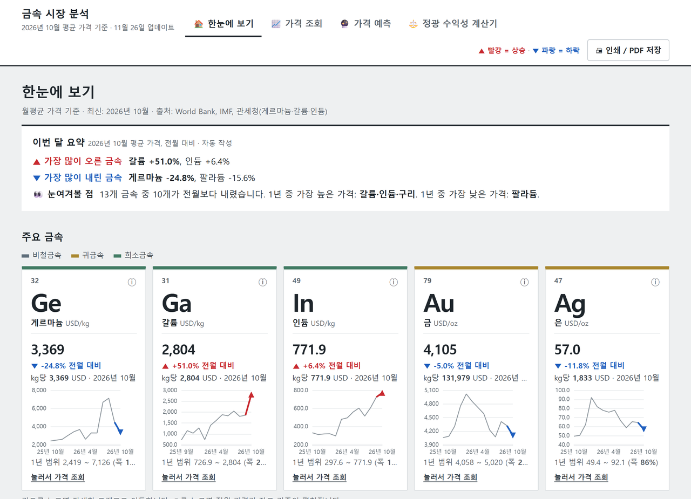
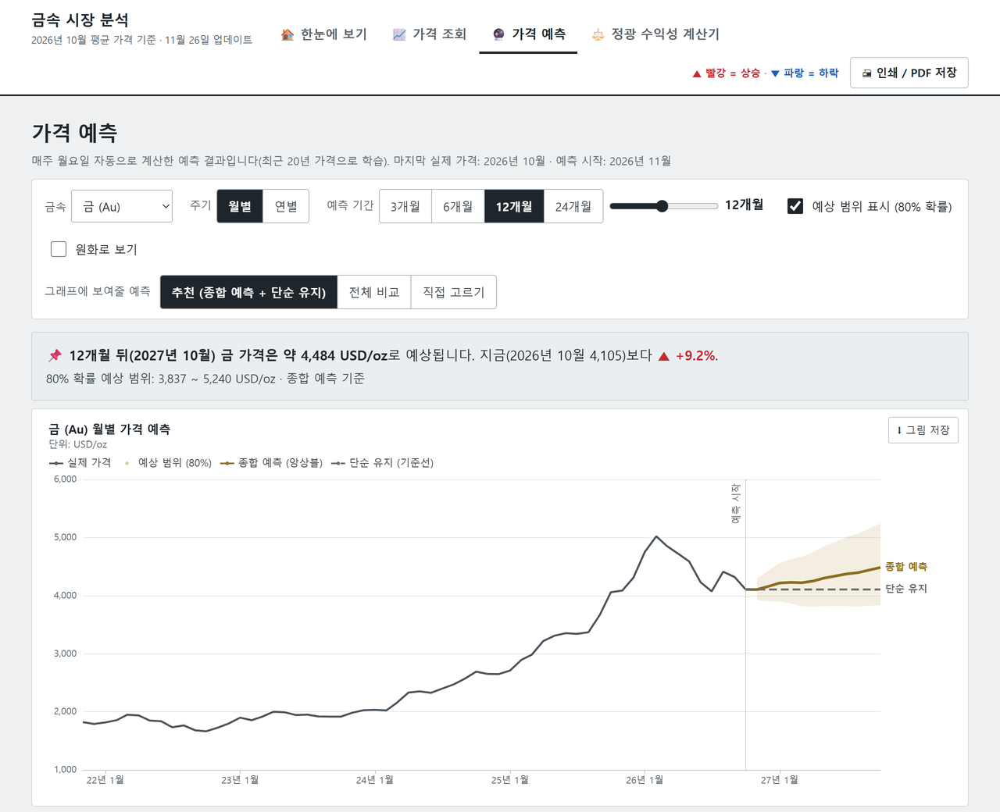
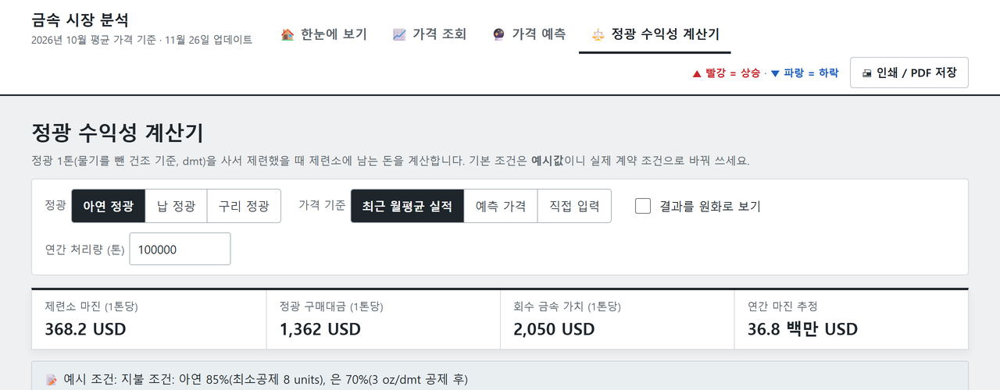

## 원자재 시장 데이터 분석과 시계열 예측

공개된 시장 데이터를 모아 **검증된 예측**과 **읽기 쉬운 화면**으로 바꾸는 일을 합니다.
예측값 하나를 내놓기보다, 그 예측이 과거에 얼마나 맞았는지를 함께 보여 주는 것을 중요하게 생각합니다.

| **Py** Python | **Pd** pandas | **Sm** statsmodels | **Pr** Prophet | **Xg** XGBoost | **Sk** scikit-learn | **St** Streamlit | **Ec** ECharts |
|:-:|:-:|:-:|:-:|:-:|:-:|:-:|:-:|

---

### 대표 프로젝트: 금속 시장 분석 도구

비철금속·귀금속·희소금속 **13종**의 가격 흐름, 예측, 정광 제련 마진을 한곳에서 보는 분석 도구입니다.
공개 자료만 사용하며, 매주 자동으로 자료를 받아 다시 계산합니다.

| 가격 예측 | 정광 수익성 계산기 |
|:-:|:-:|
|  |  |

**무엇을 하나**
- **가격 예측**: 금속 10종에 대해 7가지 기법(단순 유지, 이동평균, ETS, ARIMA, Prophet, XGBoost, 랜덤포레스트)으로 예측합니다. 과거 12개 시점으로 돌아가 12개월 앞을 맞혀 보는 검증을 거쳐, 오차가 작은 상위 3개 기법을 섞어 **종합 예측**을 만듭니다.
- **기준선과 비교**: 모든 예측을 "지금 가격이 그대로 유지된다"는 단순 유지 예측과 나란히 보여 줍니다. 기준선보다 나은지가 예측의 첫 번째 시험이라고 봅니다.
- **정광 수익성 계산**: 품위, 지불 비율, 공제, 회수율, TC/RC로 정광 1톤당 제련 마진을 계산합니다. 마진 구성과 가격·수수료 민감도도 함께 보여 줍니다.
- **희소금속 가격 추정**: 거래소 시세가 없는 게르마늄·갈륨·인듐은 관세청 수출입 단가로 월별 가격을 추정합니다.

**자료**
World Bank(1960년~), IMF, FRED, 한국은행 ECOS, 관세청·한국광해광업공단(공공데이터포털), USGS, CFTC

**만든 것**
- 매주 자동으로 다시 만들어지는 주간 브리핑 사이트 (신호등 지표, 해설, PDF 보고서)
- 상세 분석용 Streamlit 도구
- 인터넷 없이 파일 하나로 열리는 HTML 버전

저장소는 비공개입니다. 화면의 정광 조건은 공개용 예시값입니다.

---

### 일하는 방식

- **공개 데이터만 씁니다.** 출처를 화면마다 표시합니다.
- **예측은 검증 성적과 함께 냅니다.** 예상 범위(80%)와 과거 오차를 같이 보여 줍니다.
- **읽는 사람 기준으로 화면을 만듭니다.** 빨강은 상승, 파랑은 하락에만 쓰고, 전문 용어에는 풀이를 붙입니다.
- **AI를 도구로 씁니다.** Claude Code와 함께 자료 수집, 계산, 화면을 만듭니다.
